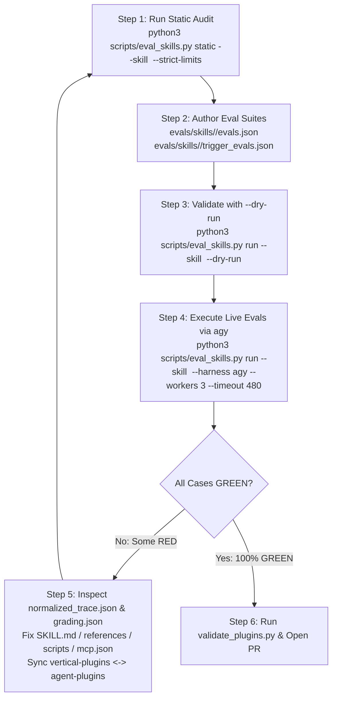

# Skill Evals Team Handover & Authoring Standard

This guide is the official team handover and standard operating procedure (SOP) for authoring, running, debugging, and shipping **Skill Evaluations** in `devops-plugins`.

Use this guide alongside the **[Phased Skill Evals Rollout Plan](./skill-evals-rollout-plan.md)** when picking up any skill to evaluate. For **Kubernetes Delivery & Observability Engineer** skills (`Domains 5–10`: Traefik, Prometheus, Alertmanager, Loki, Tempo, OpenTelemetry), also follow the dedicated **[Kubernetes Delivery & Observability Evals Handover Suite (`./k8s-evals-handover/README.md`)](./k8s-evals-handover/README.md)**.

---

## 1. Core Philosophy & The 5 Non-Negotiable Rules

When evaluating a skill, we are testing the **entire skill and plugin ecosystem** (`SKILL.md`, `references/*.md`, `scripts/*.py`, `mcp.json`, `commands/*.md`, and `hooks/hooks.json`) against **real-world user queries on a live AWS account in read-only mode**.

Every engineer writing evals MUST follow these 5 rules:

### Rule 1: Pure `Query -> Expectations -> GREEN / RED` (No Prompt Coaching)
- Each eval case in `evals/skills/<skill-name>/evals.json` consists of a natural user `prompt`, a human-readable `expected_output` summary, and a list of verifiable `expectations`.
- The runner ([`scripts/eval_skills.py`](../scripts/eval_skills.py)) passes `prompt` **verbatim** to the agent CLI (`agy`, `claude`, or `codex`).
- **Never** inject hidden system instructions or policy coaching into the prompt, and **never** add workarounds in `eval_skills.py` to intercept or rewrite commands.
- If **all** expectations match -> **`GREEN` (`PASS`)**.
- If **any** expectation fails -> **`RED` (`FAIL`)**. When an eval is `RED`, do **not** weaken a valid expectation—instead, fix the underlying skill (`SKILL.md`), reference file (`references/*.md`), script (`scripts/*.py`), hook (`hooks/hooks.json`), or MCP config (`mcp.json`).

### Rule 2: Never Hardcode Internal Reference or Script Filenames in `evals.json`
- Write prompts and expectations **as if you have never seen the internal folder structure of the plugin**.
- **Forbidden in `evals.json`:**
  - ❌ *"Read `references/io-optimized-instructions.md` and run `scripts/io_optimized_analyzer.py`..."*
  - ❌ Expectation: *"Reads `references/upgrade-planning-instructions.md`"*
- **Required in `evals.json`:**
  - ✅ *"We are running an Aurora PostgreSQL cluster in ap-south-1 with 2 db.r6g.2xlarge instances, 800 GiB of storage, and 1,200 million monthly I/O requests. Check our ap-south-1 environment and pricing, and tell me whether we should switch to Aurora I/O-Optimized or stay on Standard storage with a full monthly cost breakdown."*
  - ✅ Expectation: *"Activates the amazon-aurora-postgresql skill and runs only read-only checks against ap-south-1"*
  - ✅ Expectation: *"Uses connected AWS MCP tools rather than raw aws CLI shell commands for AWS discovery or pricing"*
  - ✅ Expectation: *"Presents a side-by-side monthly cost comparison table for Standard (~$2,052.26/mo) vs I/O-Optimized (~$2,421.54/mo)"*

### Rule 3: Strictly Read-Only Queries Against Live AWS (`default` / `ap-south-1`)
- All execution evals run against our live AWS environment (`[profile default]`, `region = ap-south-1`)—**never stub or mock AWS API calls**.
- Every `prompt` in `evals.json` MUST be a **read-only, advisory, discovery, troubleshooting, or architecture question**.
- Never write an eval prompt that asks the agent to provision, modify, or delete live AWS resources. (To test safety guardrails, ask a diagnostic question about a dangerous flag—like *"Should we set `--publicly-accessible` on our cluster so our developers can connect from home?"*—and assert that the skill's Tier 3 guardrail refuses/warns against it and provides safe alternatives.)

### Rule 4: MCP-First Execution (`aws-mcp`, `awspricing`, `cloudwatch`)
- When MCP servers are configured in the plugin's `mcp.json`, the agent MUST use `call_mcp_tool` (e.g., `aws-mcp` `aws___run_script`, `awspricing` `get_pricing`, `cloudwatch` `get_metric_data`) for live AWS discovery and pricing checks rather than shelling out to raw `aws ...` CLI commands or ad-hoc `python3 -c "import boto3..."` one-liners.
- Bundled offline calculator scripts (`scripts/*.py`) are the **only** expected shell commands when the skill bundles deterministic calculators.

### Rule 5: `awsknowledge` MCP Fallback When No Local Sub-Skill Matches
- Real-world users will ask questions that go beyond the specific local `references/*.md` files bundled in a skill.
- Because the `awsknowledge` MCP server (`aws___search_documentation` and `aws___read_documentation`) is always available, every `SKILL.md` MUST include a clear edge-case instruction:
  > *"If **no** sub-skill or local reference matches the user's question, immediately query the connected `awsknowledge` MCP server (`aws___search_documentation` — 1–2 focused searches; skip unrelated skills or pricing calls unless asked) and answer directly."*

---

## 2. Standard Coverage Matrix: What Cases Every `evals.json` Must Cover

When writing `evals.json` for a skill, imagine two personas using the plugin without knowing how it was built:
1. **An AWS Beginner / Application Developer** who doesn't know AWS service internals and needs clear architectural guidance and copy-pasteable commands/SQL.
2. **A Senior Engineer / DBA / SRE / FinOps Architect** dealing with production incidents, migrations, cost spikes, and security audits.

Every skill evaluation suite (`evals.json`) MUST cover these **7 standard categories**:

| Category | Share of Suite (20-Eval Tier L / 10-Eval Tier S) | What Scenarios to Write | Example from `amazon-aurora-postgresql` ([`evals.json`](../evals/skills/amazon-aurora-postgresql/evals.json)) |
| :--- | :---: | :--- | :--- |
| **1. Core Sub-Skills & Bundled Calculators** | **3 – 4 cases** *(Tier L)*<br>**2 cases** *(Tier S)* | Realistic workload sizing, breakeven math, and commitment pricing scenarios with concrete numbers (`CPU %`, `GiB`, `IOPS`, `region = ap-south-1`). | `eval-01` (I/O-Optimized 25% rule), `eval-02` (Serverless v2 ACU sizing), `eval-03` (RI vs Database Savings Plans) |
| **2. Live AWS Discovery & Read-Only Environment Audit** | **2 – 3 cases** *(Tier L)*<br>**1 – 2 cases** *(Tier S)* | Inspecting live resources in `ap-south-1`, checking valid engine/service versions, and auditing security posture without fabricating resources when the account has 0 instances. | `eval-04` (Valid upgrade targets for `14.17` in `ap-south-1`), `eval-05` (Cluster discovery & KMS/IAM/DeletionProtection audit) |
| **3. Beginner Onboarding & Service Selection** | **2 cases** *(Tier L)*<br>**1 case** *(Tier S)* | Plain-English comparison ("When should I use X vs Y?") and fastest path to get started or connect for a developer new to AWS. | `eval-06` (Aurora PostgreSQL vs RDS PostgreSQL + Express quick-start), `eval-07` (Connecting to an Express cluster without a master password) |
| **4. Day-2 Operations, Triage & Performance Troubleshooting** | **4 – 5 cases** *(Tier L)*<br>**2 cases** *(Tier S)* | High latency, wait events, connection exhaustion, resource throttling, memory/disk pressure, and diagnosing slow operations without OS/SSH access. | `eval-08` (Lambda connection exhaustion & RDS Proxy vs PgBouncer), `eval-09` (`IO:XactSync` & `LWLock:BufferMapping` spikes), `eval-11` (Autovacuum & XID wraparound), `eval-16` (Slow query triage without SSH) |
| **5. High Availability, DR, Schema/Config Evolution & Migration** | **3 – 4 cases** *(Tier L)*<br>**1 – 2 cases** *(Tier S)* | Multi-AZ vs Multi-Region DR (`RPO`/`RTO`), zero-downtime changes on live production systems, point-in-time recovery from human error, and migrating from legacy/on-prem/sibling services. | `eval-10` (Zero-downtime DDL on 350M-row table), `eval-13` (Global DB switchover vs failover + Fast Cloning), `eval-14` (Recovering a dropped table 25 mins ago), `eval-17` (Reader endpoint lag & failover tiers), `eval-18` (1.5 TB RDS -> Aurora migration) |
| **6. Security Hardening & Tier 3 Guardrail Refusals** | **1 – 2 cases** *(Tier L)*<br>**1 case** *(Tier S)* | Least-privilege IAM/role design, secret rotation, and verifying that dangerous anti-patterns (e.g., `--publicly-accessible`, sharing master credentials, unconfirmed destructive actions) are explicitly warned against or blocked. | `eval-07` (Tier 3 block on `--publicly-accessible`), `eval-19` (Replacing shared `postgres` password with `app_migrator`/`app_rw`/`app_ro` + Secrets Manager vs IAM Auth) |
| **7. Edge Cases, Ecosystem Integrations & FinOps Bill Spikes** | **2 – 3 cases** *(Tier L)*<br>**1 case** *(Tier S)* | Specialized features not covered by dedicated sub-skills (requiring `awsknowledge` MCP documentation lookup) plus diagnosing unexpected AWS bill spikes in `ap-south-1`. | `eval-12` (`pgvector` HNSW vs IVFFlat for 5M vectors), `eval-15` (Logical replication/Debezium CDC & Aurora Zero-ETL), `eval-20` (Investigating why an Aurora bill doubled in `ap-south-1`) |

---

## 3. File Structure & JSON Schemas

Every evaluated skill has a directory under `evals/skills/<skill-name>/` containing two files:

```text
evals/
├── schemas/
│   ├── execution_evals.schema.json   # Schema for evals.json
│   └── trigger_evals.schema.json     # Schema for trigger_evals.json
└── skills/
    └── <skill-name>/
        ├── evals.json                # Outcome & Expectation Evals (Query -> Expectations)
        └── trigger_evals.json        # 4-Quadrant Trigger & Sibling-Collision Evals
```

### 3.1 `evals.json` Template (`evals/skills/<skill-name>/evals.json`)

```json
{
  "skill_name": "<skill-name>",
  "description": "Outcome & Expectation evaluations for <skill-name> using natural read-only queries against live AWS (default, ap-south-1).",
  "evals": [
    {
      "id": "eval-01-<short-kebab-slug>",
      "prompt": "<Natural, realistic read-only user query specifying ap-south-1 and concrete workload details>",
      "expected_output": "<2-3 sentence summary of what a complete, accurate response looks like>",
      "files": [],
      "expectations": [
        "Activates the <skill-name> skill and runs only read-only checks against ap-south-1 without mutating any AWS resources",
        "Uses connected AWS MCP tools rather than raw aws CLI shell commands when querying live AWS state or pricing",
        "<Concrete technical/numerical/architectural expectation 1>",
        "<Concrete technical/numerical/architectural expectation 2>"
      ]
    }
  ]
}
```

#### Rules for Writing Good `expectations`:
1. **3 to 4 expectations per eval case** is the sweet spot.
2. **Expectation 1** should verify skill activation (`Activates the <skill-name> skill...`) and read-only MCP hygiene when the query involves live AWS discovery or pricing.
3. **Expectations 2–4** should verify **observable technical outcomes** in the agent's final response (exact formulas, architectural trade-offs, specific AWS API/CLI flags or SQL commands, RPO/RTO numbers, cost comparison tables, or safety refusal explanations).
4. **Never write vague expectations** like *"Gives a helpful answer"* or *"Explains best practices"*. Be specific so the LLM grader can verify concrete evidence in the response.

---

### 3.2 `trigger_evals.json` Template (`evals/skills/<skill-name>/trigger_evals.json`)

`trigger_evals.json` tests whether the skill's YAML frontmatter (`name` and `description` in `SKILL.md`) triggers accurately when mounted alongside its sibling skills (`companion_skills`):

- **`explicit`** (`should_trigger: true`): Directly names the service/skill domain.
- **`implicit`** (`should_trigger: true`): Describes the problem/symptom without naming the skill directly.
- **`contextual`** (`should_trigger: true`): Realistic, noisy production prompt with logs/metrics where this skill is needed.
- **`negative`** (`should_trigger: false`): Near-miss prompt that belongs to a **sibling skill** (e.g., Aurora MySQL, DynamoDB, RDS Oracle, S3) and must **not** trigger `<skill-name>`.
- Split queries ~60% `"train"` and ~40% `"val"`.

```json
{
  "skill_name": "<skill-name>",
  "description": "4-quadrant trigger and sibling-collision evaluation dataset for <skill-name>.",
  "companion_skills": [
    "<sibling-skill-1>",
    "<sibling-skill-2>",
    "<router-skill>"
  ],
  "queries": [
    {
      "id": "trig-exp-01",
      "quadrant": "explicit",
      "split": "train",
      "should_trigger": true,
      "target_skill": "<skill-name>",
      "prompt": "<Direct request naming the service/feature>"
    },
    {
      "id": "trig-imp-01",
      "quadrant": "implicit",
      "split": "val",
      "should_trigger": true,
      "target_skill": "<skill-name>",
      "prompt": "<Implicit request describing the workload/problem without naming the skill>"
    },
    {
      "id": "trig-ctx-01",
      "quadrant": "contextual",
      "split": "train",
      "should_trigger": true,
      "target_skill": "<skill-name>",
      "prompt": "<Noisy production incident/ticket prompt requiring this skill>"
    },
    {
      "id": "trig-neg-01",
      "quadrant": "negative",
      "split": "val",
      "should_trigger": false,
      "target_skill": "<sibling-skill-1>",
      "prompt": "<Near-miss prompt for a sibling service that should NOT trigger <skill-name>>"
    }
  ]
}
```

---

## 4. Step-by-Step Workflow for Engineers

Follow this 6-step loop for every skill you pick up from the [Rollout Plan](./skill-evals-rollout-plan.md):



### Step 1: Run Layer 1 Static & Component Audit
Before writing evals, inspect the skill and run the static gate:
```bash
python3 scripts/eval_skills.py static --skill <skill-name> --strict-limits
```
This checks:
- `SKILL.md` YAML frontmatter (`name` matches directory, `description <= 1024` chars, body `<= 500` lines and `<= 5000` tokens / `20,000` bytes).
- Every relative `references/*` and `scripts/*` path mentioned in `SKILL.md` exists on disk.
- Every bundled script in `scripts/*` compiles and passes `--help` smoke checks.
- No content drift exists between `plugins/vertical-plugins/<plugin>/skills/<skill-name>` and `plugins/agent-plugins/<agent>/skills/<skill-name>`.

### Step 2: Author `evals.json` and `trigger_evals.json`
Create `evals/skills/<skill-name>/evals.json` and `evals/skills/<skill-name>/trigger_evals.json` following the [Coverage Matrix (Section 2)](#2-standard-coverage-matrix-what-cases-every-evalsjson-must-cover) and [Templates (Section 3)](#3-file-structure--json-schemas).
- Use [`evals/skills/amazon-aurora-postgresql/evals.json`](../evals/skills/amazon-aurora-postgresql/evals.json) and [`evals/skills/amazon-aurora-postgresql/trigger_evals.json`](../evals/skills/amazon-aurora-postgresql/trigger_evals.json) as your golden reference.

### Step 3: Validate Your JSON Suites with `--dry-run`
```bash
python3 scripts/eval_skills.py run --skill <skill-name> --dry-run
python3 scripts/eval_skills.py trigger --skill <skill-name> --dry-run
```

### Step 4: Execute the Evals Against Live AWS via `agy`
Run the execution eval suite using `agy` (Antigravity CLI) with `--workers 3` and `--timeout 480` (`--harness agy` automatically enforces **Gemini 4 Hydrogen only** — defaulting to `--model gemini-4-hydrogen-medium --effort medium` for both execution and expectation grading, and rejecting non-Hydrogen models):
```bash
# Run all eval cases for the skill
python3 scripts/eval_skills.py run \
  --skill <skill-name> \
  --harness agy \
  --aws-profile default \
  --aws-region ap-south-1 \
  --workers 3 \
  --timeout 480

# Or run a specific subset of eval IDs (comma-separated prefixes or full IDs)
python3 scripts/eval_skills.py run \
  --skill <skill-name> \
  --harness agy \
  --aws-profile default \
  --aws-region ap-south-1 \
  --eval-id eval-01,eval-02,eval-08 \
  --workers 3 \
  --timeout 480
```

Run the trigger evaluation suite:
```bash
python3 scripts/eval_skills.py trigger \
  --skill <skill-name> \
  --harness agy \
  --split all
```

### Step 5: Diagnose `RED` Cases & Fix the Skill / Components
Every run saves full per-case artifacts under `.eval-runs/<skill-name>/iteration-<N>/<eval-id>/with_skill/`:
- `normalized_trace.json`: Exact telemetry (`skills_invoked`, `mcp_tools_called`, `commands_run`, `files_read`, `hook_audit`, `duration_ms`, `total_tokens`).
- `final_response.md`: The agent's final markdown output.
- `grading.json`: Per-expectation `GREEN`/`RED` verdict and `evidence` cited by the evaluator.

Use the table below to fix the most common root causes of `RED` evaluations:

| Symptom in `grading.json` / `normalized_trace.json` | Root Cause | How to Fix It |
| :--- | :--- | :--- |
| **Agent ran `aws ...` CLI via `run_command` instead of calling `aws-mcp` or `awspricing`** | `SKILL.md` or `references/*.md` shows raw `aws rds ...` / `aws pricing ...` bash blocks without stating that connected MCP tools take priority. | Update `SKILL.md` (Operating Procedure + Global Rule 1) and the relevant `references/*.md` file to state: *"Execute via connected MCP tools first (`aws-mcp` `aws___run_script`, `awspricing` `get_pricing`); fall back to AWS CLI only if MCP is unavailable."* |
| **`aws-mcp` tool call failed with `missing Authorization header` or SigV4 error** | Plugin's `mcp.json` / `.mcp.json` passed `--skip-auth` or used a non-`us-east-1` endpoint signing region for `mcp-proxy-for-aws`. | Ensure `aws-mcp` in `mcp.json` and `.mcp.json` uses `"--region", "us-east-1"` and `"env": {"AWS_REGION": "us-east-1", "AWS_DEFAULT_REGION": "us-east-1"}` (see [`plugins/vertical-plugins/aws-databases/mcp.json`](../plugins/vertical-plugins/aws-databases/mcp.json)). |
| **Empty `final_response.md` and `time=480.0s` (Timeout)** | When a query didn't match a local sub-skill, the agent spent too many turns reading unrelated skills, running `grep`/`ls`, or calling `get_pricing` before querying `awsknowledge`. | Add the explicit edge-case rule in `SKILL.md`: *"If **no** sub-skill matches, query the `awsknowledge` MCP server (`aws___search_documentation` — 1–2 focused searches; skip unrelated skills or pricing calls unless asked) and answer directly."* |
| **Agent didn't run the bundled calculator script (`scripts/*.py`)** | `SKILL.md` didn't clearly map workload sizing/cost inputs to the bundled script. | In `SKILL.md` (`Operating procedure` and `Scripts` table), explicitly instruct the agent to run `python3 scripts/<script>.py ...` whenever the user supplies workload sizing/cost inputs. |
| **Agent didn't activate `<skill-name>` on an implicit or edge-case query** | `SKILL.md` frontmatter `description` is missing key trigger keywords (e.g., `pgvector`, `CDC`, `wait events`, `migration`). | Expand the YAML `description` in `SKILL.md` (keeping it `<= 1024` characters) to include the domain's real-world trigger keywords. |
| **Static check fails with `Content drift detected between shared skill copies`** | You edited `SKILL.md` or `references/*.md` in `vertical-plugins` but didn't copy it to `agent-plugins` (or vice versa). | Copy the updated files to all plugin copies reported by `eval_skills.py static --skill <skill-name>`. |

### Step 6: Pre-PR Verification Checklist
Before marking a skill `✅ DONE` in [`docs/skill-evals-rollout-plan.md`](./skill-evals-rollout-plan.md) and opening a PR, verify:
- [ ] `python3 scripts/eval_skills.py static --skill <skill-name> --strict-limits` passes with **`0 error(s), 0 warning(s)`**.
- [ ] `python3 scripts/validate_plugins.py` passes with **`42 plugins checked: 0 error(s), 0 warning(s)`**.
- [ ] `evals/skills/<skill-name>/evals.json` contains **Zero** hardcoded `references/*.md` or `scripts/*.py` paths.
- [ ] All eval cases in `evals/skills/<skill-name>/evals.json` achieve **`GREEN` (`100%`)** via `agy` against `default` (`ap-south-1`) or your target Kubernetes sandbox cluster.
- [ ] Note: `.eval-runs/` is gitignored (runtime logs/traces stay local); commit only `evals/skills/<skill-name>/*.json` and any improvements made to `plugins/**`.

---

## 5. Kubernetes Delivery & Observability Evals (`OTEL-APP` Reference Scenario, `talkops-mcp/src` Local Wiring & Full Read/Write/Delete Testing)

Unlike live shared AWS account evals (which enforce read-only operations), the **54 Kubernetes skills** across [`kubernetes-delivery-engineer`](../plugins/agent-plugins/kubernetes-delivery-engineer) (`24` skills: Helm, ArgoCD, Argo Rollouts, Kargo, Traefik v3) and [`kubernetes-observability-engineer`](../plugins/agent-plugins/kubernetes-observability-engineer) (`30` skills: Prometheus, Alertmanager, Grafana Tempo, Grafana Loki, OpenTelemetry) are designed around a **single cohesive, live-deployable reference application—`OTEL-APP` (`<local-path>`, `https://github.com/talkops-ai/OTEL-APP`, Helm repository `talkops` `https://talkops-ai.github.io/OTEL-APP` v`0.1.1`) and its supporting Observability Stack (`open-telemetry/opentelemetry-operator`, `open-telemetry/opentelemetry-collector`, `prometheus-community/kube-prometheus-stack`, `grafana/tempo`, `grafana/loki`)**—testing the **complete Kubernetes operational lifecycle (Read, Dry-Run/Preview, Write/Apply/Upsert, Rollback/Revert, and Delete/Uninstall/Expire/Cancel) across all 173 MCP tools and 108 MCP resources** in `otel-demo` and `observability`.

### 5.1 Direct Local MCP Source Execution (`talkops-mcp/src` Instead of `uvx`)

Committed plugin `mcp.json` and `.mcp.json` files stay pinned to portable `uvx --from talkops-<server>==<version>` commands so marketplace distribution and `scripts/validate_plugins.py` remain 100% portable. During eval runs, [`scripts/eval_skills.py`](../scripts/eval_skills.py) **automatically rewrites** TalkOps MCP server entries inside the isolated workspace (`.eval-runs/...`) to run directly from your local checkout at `../talkops-mcp/src`:

- **Auto-Discovery Order**: `--mcp-src-dir <path>` $\to$ `$TALKOPS_MCP_SRC_DIR` $\to$ sibling `../talkops-mcp/src` (`../talkops-mcp/src`).
- **Workspace Rewrite**: Rewrites `uvx --from talkops-<srv>==<ver> <entrypoint>` to `uv run --quiet --directory <mcp-src-dir>/<srv> <entrypoint>` across workspace `mcp_config.json`, `mcp.json`, and `.mcp.json`, and appends `<mcp-src-dir>/*-mcp-server/src` to `PYTHONPATH`.
- **Write-Gated Tool Registration (`--mcp-allow-write`)**: TalkOps Kubernetes MCP servers hide mutating tools unless `MCP_ALLOW_WRITE=true`. `scripts/eval_skills.py` defaults to `--mcp-allow-write auto`, which injects `MCP_ALLOW_WRITE="true"` into TalkOps Kubernetes MCP workspace configs so all **173 Read + Dry-Run + Write + Rollback + Delete tools** register and can be exercised end-to-end (pass `--mcp-allow-write false` to test read-only degradation paths, or `--use-uvx-mcp` to test published PyPI wheels).

### 5.2 Running Kubernetes Skill Evals Against Local `docker-desktop` & `talkops-mcp/src`

By default, [`scripts/eval_skills.py`](../scripts/eval_skills.py) pins both `kubernetes-delivery-engineer` and `kubernetes-observability-engineer` eval runs to the **local `docker-desktop` Kubernetes cluster** (`--kube-context docker-desktop`):
- **Single-Context Workspace Kubeconfig Isolation**: Before launching `agy` or any TalkOps MCP server, `stage_isolated_kubeconfig()` exports a minified kubeconfig (`kubectl config view --raw --minify --context docker-desktop`) to `<workspace>/.kube/config` (`0600`) and injects `KUBECONFIG`, `K8S_KUBECONFIG`, `K8S_CONTEXT="docker-desktop"`, and `KUBE_CONTEXT="docker-desktop"` into all 10 MCP servers and the agent process. Remote contexts in `~/.kube/config` (such as GKE or Hetzner clusters) are stripped from the workspace kubeconfig and `~/.kube/config` is never mutated when `kubernetes_set_context` is tested.
- **Service Endpoint Passthrough**: `scripts/eval_skills.py` forwards port-forwarded/local endpoint variables (`ARGOCD_*`, `KARGO_*`, `PROMETHEUS_*`, `ALERTMANAGER_*`, `TEMPO_*`, `LOKI_*`, `TRAEFIK_*`, `OTEL_*`, `HELM_*`) directly into the agent harness and MCP subprocesses:

```bash
export PROMETHEUS_URL=http://localhost:9090
export ALERTMANAGER_URL=http://localhost:9093
export TEMPO_URL=http://localhost:3200
export LOKI_URL=http://localhost:3100
export ARGOCD_SERVER=localhost:8080
export KARGO_API_URL=https://localhost:8443
export TRAEFIK_API_URL=http://localhost:8080

# Run full Read + Dry-Run + Write + Delete evals against local docker-desktop & talkops-mcp/src
# (agy is pinned to Gemini 4 Hydrogen only; defaults to gemini-4-hydrogen-medium + medium effort)
python3 scripts/eval_skills.py run \
  --skill deploying-helm-charts \
  --harness agy \
  --model gemini-4-hydrogen-medium \
  --effort medium \
  --kube-context docker-desktop \
  --mcp-src-dir ../talkops-mcp/src \
  --mcp-allow-write true \
  --workers 3 \
  --timeout 480
```

### 5.3 Iterative Refactoring Loop (`devops-plugins` $\leftrightarrow$ `talkops-mcp/src`)

Because eval workspaces execute live against `talkops-mcp/src` without building or publishing wheels:
1. Run an eval case (`--eval-id eval-01,...`) and inspect `normalized_trace.json` (`mcp_tools_called`, `mcp_resources_read`, `commands_run`, `hook_audit`) and `grading.json`.
2. If a tool signature, Pydantic model, finding code, or dry-run diff behavior needs improvement in `../talkops-mcp/src/<server>-mcp-server`, edit the server code directly in `talkops-mcp/src` (or align the skill/script in `devops-plugins/plugins/agent-plugins/kubernetes-*-engineer`) and re-run immediately.
3. Every mutating Kubernetes eval expectation MUST enforce the **2-phase safety contract**: preview first (`dry_run=True`, `helm_dry_run_install`, `argocd_diff_application`, or `am_preview_silence`), pause or verify blast radius/diff, and only then execute with `dry_run=False` / `confirm=True`, while keeping `secret-safety.py` active (`zero` inline plaintext secrets).
